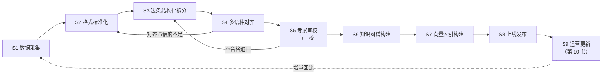
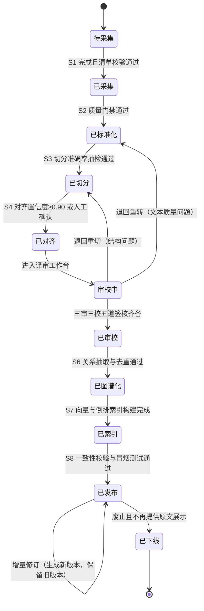
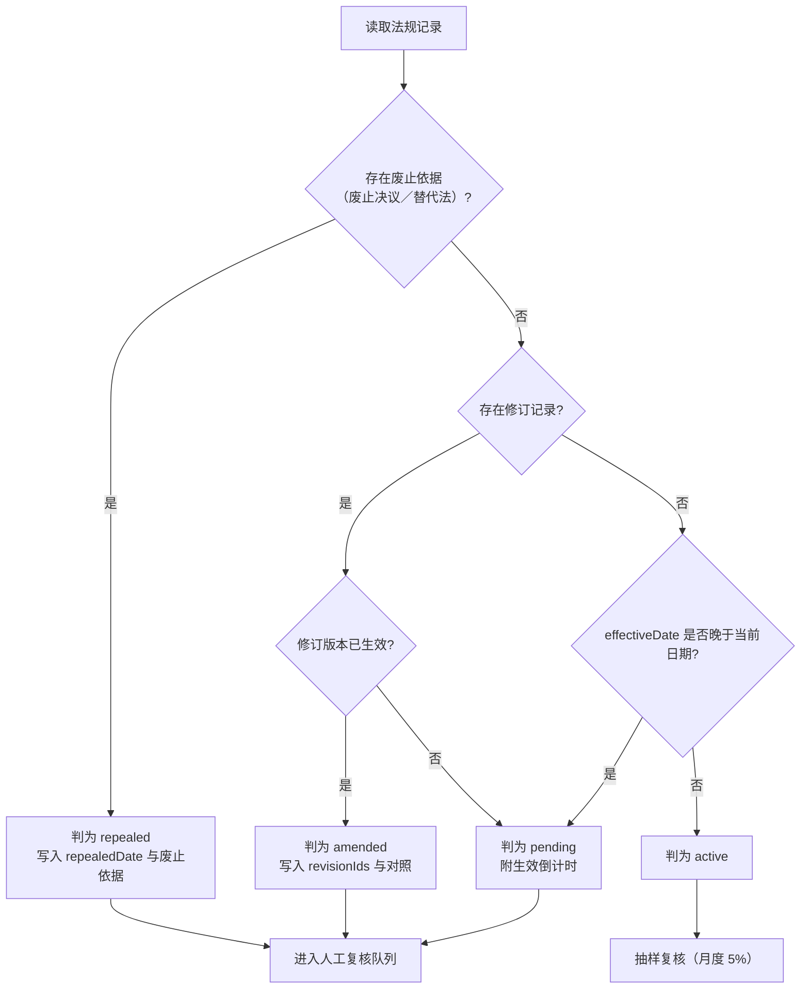
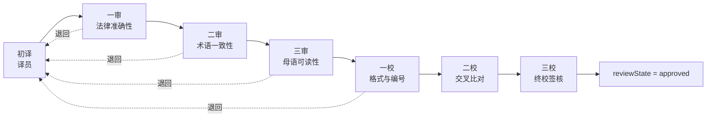
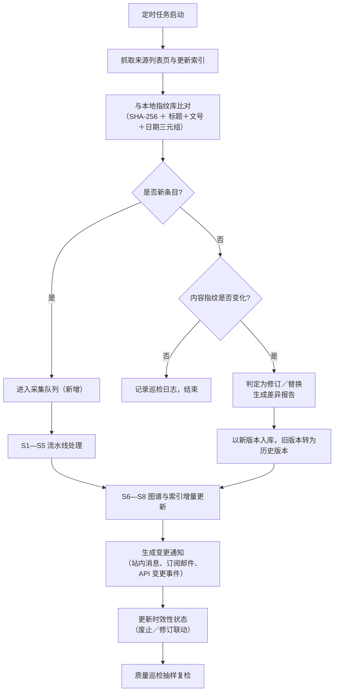
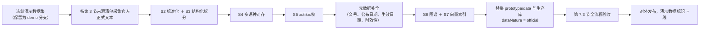

# 中国—东盟法律法规数据库 · 数据建设方案

> 本文档是《中国—东盟法律法规数据库》（英文全称 China–ASEAN Laws and Regulations Database，缩写 CALR）的数据建设执行文件，用于回答评审专家对「数据从哪里来、怎么加工、如何保证准确、怎样持续更新、合规底线在哪里」的全部追问。全文指标口径与 `docs/00-项目基线.md` 第 4 节完全一致，命名、代码、字段、色标均引用基线，不作二次定义。

---

## 1. 文档信息

### 1.1 版本与编制信息

| 项目 | 内容 |
| :--- | :--- |
| 文档名称／编号／路径 | 数据建设方案 ｜ D4 ｜ `docs/03-数据建设方案.md` |
| 版本号／编制日期 | v1.0 ｜ 2026-10-01 |
| 对应基线 | `docs/00-项目基线.md` v1.0 |
| 参赛队／赛道／方向 | 上海对外经贸大学一粒橡子队 ｜ 高校学生赛道 ｜ 比赛内容方向（五）面向东盟法律服务方向 |
| 密级 | 内部（对外提交版可标注「可公开」） |
| 修订规则 | 与基线冲突时以基线为准；修订须同步检查原型数据集、申报书数据章节、演示脚本旁白 |

### 1.2 编制依据

**一、大赛公告与申报材料要求**

1. 大赛公告第（二）项「参赛项目要求」：参赛项目必须为原创成果或依法取得完整合法授权，参赛队须对知识产权、数据来源、内容合规性及技术合法性负责，不得存在侵权、泄密或违反相关法律法规等情形。本方案第 8 节据此设置来源合法性审查清单与「不得侵权／泄密」自查表。
2. 大赛公告第十一节第（一）项「知识产权」：参赛队应保证参赛行为和参赛过程不得侵犯或非法使用第三方的知识产权等。本方案为全部外部素材建立逐条台账，确保可举证。
3. 附件 2《项目申报书》填写说明第二条：涉及使用第三方数据、代码或模型的，须在申报书中明确标注来源并说明使用授权情况。本方案附表 A 即该要求的数据侧底账。
4. 附件 2 填写说明第三条：涉及东盟各国法律法规、政策文件或案例数据的，应注明所引用法律文件的国别、名称及生效版本，确保信息来源合法、权威、可追溯。第 5.4 节 `country`、`title`、`docNumber`、`effectiveDate`、`status` 五个字段为该要求在系统层面的强制落地。
5. 附件 2 填写说明第四条（英文名词首次出现须写全称与缩写）、附件 3《申报主体责任声明》（作品须为独立创作或已取得合法授权，已尽合理审慎注意义务，不侵犯第三方知识产权、商业秘密及名誉权）：分别由本文件行文纪律与第 8.2、8.6 小节承接。

**二、法律法规与国家标准**

| 依据 | 本方案对应条款 |
| :--- | :--- |
| 《中华人民共和国著作权法》关于官方文件不适用著作权保护、翻译作品著作权的规定 | 第 8.2 节 |
| 《中华人民共和国数据安全法》《中华人民共和国网络安全法》 | 第 8.4、8.5 节 |
| 《中华人民共和国个人信息保护法》（最小必要、告知同意、跨境提供） | 第 8.3 节 |
| 《数据出境安全评估办法》及促进和规范数据跨境流动的相关规定 | 第 8.4 节 |
| 《信息安全技术 个人信息安全规范》等推荐性国家标准关于去标识化的要求 | 第 8.3 节 |
| 各国法律信息公开制度：越南法律文本颁布制度、泰国政府公报制度、印尼法律文件公开门户制度、马来西亚法律修订与出版制度、新加坡电子立法制度、菲律宾官方公报制度、文莱总检察署法律公布制度、柬埔寨官方公报制度、老挝官方公报制度、缅甸法律公布制度、东帝汶共和国日报制度 | 第 3 节各法域合规依据列 |

**三、技术要求**：《项目提示词》第七节规定的五类数据来源与八步加工流水线、第 7.3 节规定的首批建设范围（5 国／5 领域／6 语种）构成第 2、4 节的直接输入；基线第 9 节规定的生产技术架构（Neo4j、Milvus、Elasticsearch、BGE-M3、领域 NMT、私有化部署）构成第 4、9 节的实现约束。

### 1.3 文档用途与读者

| 读者 | 关注点 | 建议阅读章节 |
| :--- | :--- | :--- |
| 大赛评审专家 | 可操作性、合规性、数据要素价值 | 第 2、3、7、8、12 节 |
| 项目负责人 | 里程碑、工作量、风险 | 第 2、4、10、12 节 |
| 数据工程实施人员 | 流水线、结构化规范、索引构建 | 第 4、5、9 节 |
| 译审专家与母语审校 | 翻译流程、术语库、质检抽样 | 第 6、7 节 |
| 合规与法务 | 授权、知识产权、出境评估 | 第 8 节 |

---

## 2. 数据建设目标与口径

### 2.1 权威口径（与基线第 4 节完全一致，不得改写）

| 指标 | 口径 | 数值 |
| :--- | :--- | :--- |
| 法域覆盖 | 东盟 11 国 + 中国 | 12 |
| 语种 | 界面与语料覆盖语种 | 7（中文、英文、越南语、泰语、印尼语、马来语、缅甸语）+ 扩展 高棉语、老挝语 |
| 语料规模 | 东盟法律行业语料库 | 10 万余部法规、超 5 亿字 |
| 平行语料 | 已完成的重点法规翻译 | 300 余万字、百余部重点法规 |
| MVP 首批 | 国家 5 / 领域 5 / 语种 6 | VN、TH、ID、MY、SG ｜ 外商投资、商事合同、劳动用工、知识产权、数据合规 ｜ 中英越泰印尼马来 |
| 原型演示数据 | 原型内置演示数据集 | 12 法域、60+ 部法规、300+ 条条文、120+ 条术语（标注「演示数据」） |

「10 万余部法规、超 5 亿字」为东盟法律行业语料库的**汇聚口径**（已完成采集与清洗、可支撑检索与模型训练的存量规模）；「300 余万字、百余部重点法规」为**已完成译审、可直接进入平台展示的高价值平行语料口径**。两者是包含关系而非并列关系：禁止将 300 万字平行语料计入 5 亿字语料规模，亦禁止宣称 10 万部语料已全部完成翻译。

### 2.2 三阶段目标分解

「法规数」为入库并通过质量门禁的法规部数；「条文数」为结构化切分并绑定锚点的条文条数；「覆盖率」指 MVP 五大领域内已完成结构化与时效性标注的法规占该国该领域已公布法规的比例。

| 维度 | V1（MVP，第 1—16 周） | V2（扩展，第 17—40 周） | V3（全覆盖，第 41 周起 12 个月） |
| :--- | :--- | :--- | :--- |
| 法域数 | 6（VN、TH、ID、MY、SG、CN） | 9（增 PH、KH、LA） | 12（增 BN、MM、TL） |
| 语种数 | 6（中、英、越、泰、印尼、马来） | 7（增缅甸语） | 7 + 扩展高棉语、老挝语 |
| 领域数 | 5 | 10 | 18 |
| 法规数 | 15 000 部 | 45 000 部 | 100 000 部以上 |
| 条文数 | 38 万条 | 115 万条 | 250 万条以上 |
| 平行语料 | 120 万字 | 240 万字 | 300 万字以上 |
| 重点翻译法规 | 40 部 | 80 部 | 100 部以上 |
| 术语条目 | 2 000 条 | 6 000 条 | 12 000 条 |
| 领域覆盖率 | 60% | 80% | 95% |
| 时效性标注覆盖率 | 100% | 100% | 100% |
| 全文可读（`coverage = full`）占比 | 85% | 95% | 98% |
| 交付形态 | 原型数据集 + 生产库骨架 | 生产库 + 对外开放检索 | 全国性数据基础设施 |

`coverage` 字段口径沿用基线第 6 节：`full` 表示全文入库，`excerpt` 表示节选入库。V1 允许 15% 的法规以 `excerpt` 状态入库（主要为超长议会立法与附件繁杂的行政规章），但进入重点翻译清单的 40 部法规必须为 `full`。

### 2.3 数据要素价值说明

本项目的特殊性在于数据同时承担三重角色：**检索价值**（10 万部法规支撑 M1 多语种法律智能检索与 M2 分类浏览）、**模型价值**（5 亿字语料与 300 万字平行语料支撑领域 NMT 微调、BGE-M3 领域适配、AI 问答的 RAG 召回）、**资产价值**（结构化条文库、术语库、知识图谱可作为独立数据产品向法律服务机构、涉外企业、高校研究机构提供服务）。因此本方案对每个加工环节都设置数据资产化产出物要求。

---

## 3. 数据来源清单

### 3.1 分类总览

| 类别 | 首要来源 | 获取方式 | 更新频率 | 可靠性等级 |
| :--- | :--- | :--- | :--- | :--- |
| 中国法律法规 | 国家法律法规数据库 | 网站公开检索 + 数据交换 | 实时同步 | A |
| 东盟各国成文法 | 各国官方公报与法律信息门户 | 官方公报 PDF + 网站公开检索 | 每周抓取 / 每月巡检 | A |
| 国际条约协定 | 外交部条约数据库、联合国条约集、中国自由贸易区服务网 | 官网公开下载 | 每月更新 | A |
| 判例与裁判文书 | 各国最高法院官网、中国裁判文书网涉外板块 | 网站公开检索 | 每月更新 | B |
| 法律术语平行语料 | 东盟法律行业语料库（既有存量） | 内部数据交接 + 持续扩充 | 持续扩充 | A（需另行取得授权／待确认） |

可靠性等级定义：**A 级**指该国官方机构直接发布的权威文本，可作为唯一权威版本使用；**B 级**指法院或官方汇编机构发布的裁判文书与案例摘要，权威性成立但可比性受裁判层级影响，需标注法院与案号；**C 级**指第三方二手汇编或商业数据库，仅作线索发现与交叉核验，正文一律回归 A 级来源。

### 3.2 中国法律法规来源

| 编号 | 来源机构 | 官方网址 | 获取方式 | 更新频率 | 授权与合规依据 | 等级 |
| :--- | :--- | :--- | :--- | :--- | :--- | :--- |
| CN-01 | 全国人大常委会「国家法律法规数据库」 | https://flk.npc.gov.cn | 公开检索；批量同步须另行申请数据接口或签订合作文件，批量抓取前必须取得书面许可 | 实时同步（新法公布后 24 小时内） | 法律、法规及国家机关决议决定命令等官方文件依《著作权法》不适用著作权保护；仍须遵守网站使用条款与合理抓取频率 | A |
| CN-02 | 中国人大网「法律法规」栏目 | http://www.npc.gov.cn | 公开检索 + PDF 下载 | 随会议进程 | 同上 | A |
| CN-03 | 中央人民政府网「国务院政策文件库」 | https://www.gov.cn | 公开检索 + PDF 下载 | 每周 | 政府公开信息，可转载并注明来源 | A |
| CN-04 | 最高人民法院「司法解释」与「指导性案例」栏目 | https://www.court.gov.cn | 公开检索 | 每月 | 官方公开文本；指导性案例可引用，非指导性案例标注仅供参考 | A |
| CN-05 | 国家市场监督管理总局「国家标准全文公开系统」 | https://openstd.samr.gov.cn | 公开检索 + 在线阅读 | 每周 | 强制性国家标准全文公开；推荐性标准按公开范围使用 | A |
| CN-06 | 国家互联网信息办公室、工业和信息化部政策文件栏目 | https://www.cac.gov.cn、https://www.miit.gov.cn | 公开检索 | 每周 | 政府公开信息 | A |
| CN-07 | 中国裁判文书网「涉外」板块 | https://wenshu.court.gov.cn | 公开检索（须遵守该站使用规定，单案完整文书下载受平台规则约束） | 每月 | 司法公开文书；使用时须对当事人姓名、证件号、住址、联系方式作去标识化处理 | B |
| CN-08 | 商务部「中国自由贸易区服务网」 | https://fta.mofcom.gov.cn | 公开下载协定中英文文本 | 每月 | 政府公开信息 | A |

### 3.3 东盟 11 国成文法来源（逐法域）

下表覆盖基线第 2 节全部 11 个东盟法域，中国作为对照基准已在 3.2 节展开。

| 代码 | 来源机构 | 官方网址 | 获取方式 | 更新频率 | 授权与合规依据 | 等级 |
| :--- | :--- | :--- | :--- | :--- | :--- | :--- |
| VN | 司法部「越南法律数据库」 | https://vbpl.vn | 公开检索 + 单篇 PDF 下载；批量接口需另行申请许可 | 每周 | 越南法律文本依其法律文本颁布制度属公开官方信息，可用于检索与展示；批量数据获取方式需另行取得授权／待确认 | A |
| VN | 政府公报（Công báo） | https://congbao.chinhphu.vn | 官方公报 PDF | 每周 | 官方公报为权威发布载体 | A |
| VN | 国会门户 | https://quochoi.vn | 公开检索 | 每会期 | 官方公开信息 | A |
| TH | 政府公报（ราชกิจจานุเบกษา） | https://ratchakitcha.soc.go.th | 官方公报 PDF | 每周 | 公报为法律生效的法定发布载体，公开可查 | A |
| TH | 法律改革委员会「法律数据库」 | https://www.krisd.go.th | 公开检索 | 每月 | 官方公开信息 | A |
| TH | 知识产权厅、商业部 | https://www.ipthailand.go.th、https://www.moc.go.th | 公开检索 | 每月 | 官方公开信息 | A |
| ID | 法律与人权部「法律法规数据库」 | https://peraturan.go.id | 公开检索 + PDF 下载 | 每周 | 官方公开门户；批量采集前须核验门户使用条款，需另行取得授权／待确认 | A |
| ID | 国家秘书处官报与法律汇编 | https://jdih.setneg.go.id、https://www.setneg.go.id | 官方公报 PDF | 每周 | 官方发布载体 | A |
| ID | 投资协调委员会（BKPM） | https://www.bkpm.go.id | 公开检索 | 每月 | 官方公开信息 | A |
| MY | 总检察署「法律在线」 | https://www.agc.gov.my | 公开检索 + 法规 PDF 下载 | 每周 | 官方公开信息；含版式与注释的电子版转载须遵守该署使用条款 | A |
| MY | 联邦政府宪报与官方门户 | https://www.malaysia.gov.my | 官方公报 PDF | 每周 | 官方发布载体 | A |
| SG | 总检察署「新加坡法规在线」 | https://sso.agc.gov.sg | 公开检索 + 条文级页面；批量获取受站点条款约束 | 每周 | 法规文本可公开查阅；批量抓取与再分发须核验站点条款，需另行取得授权／待确认 | A |
| SG | 政府电子宪报 | https://www.egazette.gov.sg | 官方公报 PDF | 每周 | 官方发布载体 | A |
| PH | 最高法院「菲律宾法律数据库」 | https://lawphil.net | 公开检索 | 每月 | 非政府直接运营但长期作为法律界公开查阅渠道；正文须与官方公报交叉核验后方可入库 | B→A（核验后升 A） |
| PH | 官方公报（Official Gazette） | https://www.officialgazette.gov.ph | 官方公报 PDF + 公开检索 | 每周 | 官方发布载体 | A |
| PH | 国会 | https://www.congress.gov.ph | 公开检索 | 每月 | 官方公开信息 | A |
| BN | 总检察署 | https://www.agc.gov.bn | 公开检索 + 法规 PDF | 每月 | 官方公开信息；官方仅提供马来文与英文版本，其他语种译文为本项目自制，须标注「本项目译文」 | A |
| BN | 首相府官方门户与政府宪报 | https://www.gov.bn | 官方公报 PDF | 每月 | 官方发布载体 | A |
| KH | 司法部法律法规栏目 | https://www.moj.gov.kh | 公开检索 + PDF 下载 | 每月 | 官方公开信息；高棉语文本须与官方公报核验 | A |
| KH | 官方公报与部长会议、柬埔寨发展理事会 | https://www.pressocm.gov.kh、https://www.cdc.gov.kh | 官方公报 PDF | 每月 | 官方发布载体；CDC 子法令为投资领域权威补充 | A |
| LA | 官方公报（Lao Official Gazette） | http://www.laoofficialgazette.gov.la | 官方公报 PDF + 网站检索 | 每月 | 官方发布载体；老挝语文本为主，英文译文如来自官方则标注官方译文，否则标注本项目译文 | A |
| LA | 司法部与投资促进机构 | https://www.moj.gov.la、https://www.investlaos.gov.la | 公开检索 | 每月 | 官方公开信息 | A |
| MM | 司法部 | https://www.moj.gov.mm | 公开检索 | 每月 | 官方公开信息；缅甸语文本须与公布机关文本核验 | A |
| MM | 国家管理委员会办公机构「已颁布法律」栏目 | https://sacoffice.gov.mm/my/laws_page | 公开检索（缅甸语） | 每月 | 官方公布栏目，作为缅甸法的主要公开渠道 | A |
| MM | 联邦议会与政府公报 | https://www.pyidaungsu.hluttaw.mm | 官方公报 PDF | 每月 | 官方发布载体 | A |
| TL | 司法部「共和国日报」 | https://www.mj.gov.tl/jornal/ | 官方公报 PDF + 网站检索 | 每月 | 官方发布载体；德顿语与葡萄牙语双官方语言文本 | A |
| TL | 国民议会 | https://www.parlamento.tl | 公开检索 | 每月 | 官方公开信息 | A |

**关于批量获取方式**：上述门户是否需要书面数据授权、是否存在接口配额、是否允许缓存与再分发，均以门户现行使用条款为准，本方案不作预设结论；在取得明确许可前，采集限于人工或低频公开检索，速率不超过每 5 秒 1 次请求，并在 User-Agent 中标明项目身份与联系方式。涉及批量同步的正式渠道**需另行取得授权／待确认**。

### 3.4 国际条约与协定来源

| 编号 | 来源机构 | 官方网址 | 获取方式 | 更新频率 | 授权与合规依据 | 等级 |
| :--- | :--- | :--- | :--- | :--- | :--- | :--- |
| TR-01 | 中华人民共和国外交部条约数据库 | https://treaty.mfa.gov.cn | 公开检索 + 文本下载 | 每月 | 政府公开信息 | A |
| TR-02 | 联合国条约集（United Nations Treaty Collection） | https://treaties.un.org | 公开检索 + PDF | 每月 | 联合国公开出版物，引用须标注卷号与登记号 | A |
| TR-03 | 商务部中国自由贸易区服务网 | https://fta.mofcom.gov.cn | 协定中英文文本下载 | 每月 | 政府公开信息 | A |
| TR-04 | 东盟秘书处法律文书与协定栏目 | https://asean.org | 公开检索 + PDF | 每月 | 政府间组织公开文件 | A |
| TR-05 | 世界贸易组织协定文本库 | https://www.wto.org | 公开检索 | 每季度 | 国际组织公开文件 | A |
| TR-06 | 联合国国际贸易法委员会（UNCITRAL）文本库 | https://uncitral.un.org | 公开下载 | 每季度 | 国际组织公开文件 | A |
| TR-07 | 国际统一私法协会（UNIDROIT）文本库 | https://www.unidroit.org | 公开下载 | 每季度 | 国际组织公开文件 | A |

首批入库条约不少于 6 部，含《区域全面经济伙伴关系协定》（Regional Comprehensive Economic Partnership，RCEP）、《中国—东盟全面经济合作框架协议》及升级议定书、《中国—东盟投资协议》、《中国—东盟争端解决机制协议》以及联合国国际贸易法委员会与国际统一私法协会核心商事文本。

### 3.5 判例与裁判文书来源

| 编号 | 来源机构 | 官方网址 | 获取方式 | 更新频率 | 合规依据 | 等级 |
| :--- | :--- | :--- | :--- | :--- | :--- | :--- |
| CA-01 | 中国裁判文书网（涉外板块） | https://wenshu.court.gov.cn | 公开检索 | 每月 | 依法公开文书；使用时去标识化处理当事人个人信息 | B |
| CA-02 | 新加坡司法机构判例栏目 | https://www.judiciary.gov.sg | 公开检索 + PDF | 每月 | 法院官方公开判例 | A |
| CA-03 | 马来西亚联邦法院与上诉法院判例 | https://www.kehakiman.gov.my | 公开检索 | 每月 | 法院官方公开判例 | A |
| CA-04 | 菲律宾最高法院电子图书馆与官方公报 | https://elibrary.judiciary.gov.ph、https://www.officialgazette.gov.ph | 公开检索 | 每月 | 法院官方公开判例 | A |
| CA-05 | 泰国宪法法院与最高法院公开判例 | https://www.constitutionalcourt.or.th、https://www.supremecourt.or.th | 公开检索 | 每季度 | 法院官方公开判例；泰文判决须译审后方可展示译文 | A |
| CA-06 | 印度尼西亚最高法院判例检索 | https://www.mahkamahagung.go.id | 公开检索 | 每季度 | 法院官方公开渠道 | A |
| CA-07 | 越南最高人民法院公开裁判与指导性案例 | https://www.toaan.gov.vn | 公开检索 | 每季度 | 法院官方公开渠道 | A |
| CA-08 | 文莱、柬埔寨、老挝、缅甸、东帝汶司法机关公开渠道 | 见 3.3 节各法域司法部门站点 | 公开检索 | 每季度 | 各国司法公开渠道；上述五国判例公开程度差异较大，纳入范围以实际可获取的官方公开文本为限，不作数量承诺 | B |

判例数据一律使用基线第 6 节 `cases` 模型，必填字段为 `id`、`country`、`court`、`date`、`caseNo`、`name`、`summary`、`relatedLawIds`。混合法系国家（MY、BN）须在 `court` 之外标注法源类型（成文法／判例法／伊斯兰法／习惯法），对应基线第 2 节 `legalSystemTags` 约定。

### 3.6 法律术语平行语料来源

| 编号 | 来源 | 内容 | 获取方式 | 频率 | 授权与合规依据 | 等级 |
| :--- | :--- | :--- | :--- | :--- | :--- | :--- |
| PC-01 | 东盟法律行业语料库既有存量 | 7 语种法律法规 10 万多部、超 5 亿字单语语料，及已完成译审的 300 余万字平行语料 | 内部数据交接，逐批核对权属与范围 | 持续扩充 | 原始采集与使用权属链条须逐批核验，交接前须明确可再许可范围；未确认部分**需另行取得授权／待确认** | A（核验后） |
| PC-02 | 各法域官方法律文本的官方双语版本 | 官方平行对照文本，可作高质量对齐锚点 | 官方网站公开获取 | 每周 | 官方文件不适用著作权保护，可直接作为平行语料锚点 | A |
| PC-03 | 条约与协定的作准中英文对照本 | 高置信度平行句对 | 商务部、外交部官网公开下载 | 每月 | 政府公开信息 | A |
| PC-04 | 各国官方法律术语表与立法用语汇编 | 术语候选与官方译法 | 官方网站公开获取 | 每季度 | 官方公开信息 | A |
| PC-05 | 本项目自建术语库 | 术语条目、释义、多语种对应、置信度 | 三审三校过程中产出 | 持续扩充 | 本项目原创成果 | A |

### 3.7 来源准入与禁用规则

**准入规则**（须同时满足）：①发布主体为该国立法的、行政的、司法的机关或政府间组织；②网址可公开访问且可稳定复现；③文本可明确识别国别、名称、文号与生效版本；④采集行为符合该站使用条款与合理频率。

**禁用规则**：①来源不明的转载站点、网盘分享、未标注出处的二手汇编一律不作为入库依据；②学术论文、商业数据库、非官方翻译仅可作为线索发现与交叉核验材料，正文必须回归 A 级来源；③未公开征求意见稿、立法草案不得以「现行有效」状态入库，确需收录时状态标注为「尚未生效」并在摘要中说明立法进程；④任何以规避技术措施方式获取的数据一律禁止使用。

---

## 4. 数据加工流程

### 4.1 八步流水线总览

### 4.2 各步骤执行规格

**S1 数据采集**

| 项 | 内容 |
| :--- | :--- |
| 输入／输出 | 输入：第 3 节来源清单中的目标网站、公报 PDF、开放接口（如获授权）。输出：原始件仓库（MinIO `raw/` 桶）中的 PDF／HTML／DOCX 原件，以及采集清单 `crawl_manifest.csv`（URL、采集时间、HTTP 状态、字节数、SHA-256） |
| 工具／算法 | Scrapy ＋ Playwright 渲染采集；PDF 断点续传；采集器按域限速（≤1 请求／5 秒），失败重试 3 次后进入死信队列；单站点每日采集上限可配置 |
| 责任人角色／耗时 | 数据采集工程师（执行）、数据治理负责人（抽查）｜V1 首批 15 000 部约 6 人周，单部平均 2 分钟（含重试与限速） |
| 质量门禁 | 采集清单完整性 100%；无重复 URL；原件 SHA-256 唯一；单站连续失败 20 次自动熔断并告警；确权台账中该来源状态为「已核验」方可进入 S2 |

**S2 格式标准化**

| 项 | 内容 |
| :--- | :--- |
| 输入／输出 | 输入：原始件仓库中的 PDF／HTML／DOCX。输出：Unicode NFC 规范化纯文本 ＋ 结构化 JSON 骨架 ＋ 版面坐标 JSON，落 MinIO `normalized/` |
| 工具／算法 | PyMuPDF 提取文本层；扫描件走 PaddleOCR 多语种模型（含泰文、缅甸文、高棉文、老挝文识别）；版面分析分离表头、页眉页脚、页码与脚注；字符规范化（全半角、连字符、噪声字符）；双栏公报的栏序还原 |
| 责任人角色／耗时 | 数据加工工程师（执行）、质检工程师（抽检）｜V1 约 8 人周；扫描件 OCR 平均每部 3 分钟，文本层 PDF 平均每部 20 秒 |
| 质量门禁 | 文本提取正确率抽样 ≥99%；OCR 字符准确率 ≥98%；无孤立页眉页脚残留；语言识别置信度 ≥0.9；无法识别页码率 ≤0.5% |

**S3 法条结构化拆分**

| 项 | 内容 |
| :--- | :--- |
| 输入／输出 | 输入：标准化纯文本与 JSON 骨架。输出：条文级结构化记录 `articles.jsonl`，字段遵循第 5 节与附表 B |
| 工具／算法 | 规则引擎（正则 ＋ 章节词典）优先命中「编／章／节／条」标记；未命中时启用基于 XLM-R 的 BIO 序列标注模型（7 语种联合训练）识别条文边界；编号归一化器统一编号形式；处理附件、附表、过渡条款、废止条款 |
| 责任人角色／耗时 | 数据加工工程师（执行）、法律专业审校（复核）、算法工程师（模型维护）｜V1 约 10 人周；单部平均 1.5 分钟（规则命中率 ≥92%，其余走模型 ＋ 人工复核） |
| 质量门禁 | 条文切分准确率 ≥99%（每批抽检 200 条，错误 ≤2 条）；条文编号连续性与唯一性校验通过；`lawId` 与条文 `id` 全局唯一；无空条文、无跨条粘连 |

**S4 多语种对齐**

| 项 | 内容 |
| :--- | :--- |
| 输入／输出 | 输入：各语种条文级结构化记录。输出：条款对齐表 `alignments.jsonl`（对齐单位、锚点、置信度、对齐依据） |
| 工具／算法 | 三路证据融合：①条文编号锚点（`Điều 1` ↔ `Article 1` ↔ `第一条`）；②结构路径锚点（章—节—条路径哈希）；③多语种语义相似度（BGE-M3 句向量余弦相似度）。加权后输出置信度分档，规则见第 5.3 节 |
| 责任人角色／耗时 | 算法工程师（执行）、双语法律审校（复核低置信度项）｜V1 约 6 人周；单条自动对齐 <0.5 秒；中置信度人工确认平均每条 3 分钟 |
| 质量门禁 | 高置信度（≥0.90）自动入库；中置信度（0.70—0.90）须人工确认；低置信度（<0.70）不得进入正文展示；官方双语来源对齐准确率目标 ≥99.5% |

**S5 专家审校（三审三校）**

| 项 | 内容 |
| :--- | :--- |
| 输入／输出 | 输入：结构化条文 ＋ 对齐结果 ＋ 机器译文初稿。输出：已审校条文库、术语库增量、审校留痕（审校人、时间、修改前后文本、修改理由代码） |
| 工具／算法 | 审校工作台（支持逐条对照、术语提示、批量确认、修改留痕）；术语一致性自动校验脚本；译文与原文段落覆盖率校验脚本 |
| 责任人角色／耗时 | 初译、一审（法律准确性）、二审（术语一致性）、三审（母语可读性）、三校（终校与格式合规）｜见第 6.5 节；V1 重点法规 40 部（约 120 万字）合计约 22 人月 |
| 质量门禁 | 五道工序全部签核方可置 `reviewState = approved`；未签核条文以「待审校」标识展示或不展示译文；术语一致率 ≥98% |

**S6 知识图谱构建**

| 项 | 内容 |
| :--- | :--- |
| 输入／输出 | 输入：已审校条文库、术语库、条约与判例数据。输出：Neo4j 图数据（节点、关系、属性）与图谱导出包 |
| 工具／算法 | 实体识别（法规、条文、机关、术语、主题、国别、条约、判例）；关系抽取（引用、被引用、修订、废止、术语出现、主题归属、制度衔接）；规则 ＋ 模型混合；`relatedLawIds`、`citationCount`、`citedBy`、`revisionIds` 由图谱反向回写业务库 |
| 责任人角色／耗时 | 算法工程师（执行）、法律专业审校（关系质量复核）｜V1 约 5 人周；单部法规图谱化平均 8 秒 |
| 质量门禁 | 引用关系准确率 ≥97%（抽检 200 条关系）；节点去重率 100%；每条引用关系须有出处锚点，无锚点关系不发布 |

**S7 向量索引构建**

| 项 | 内容 |
| :--- | :--- |
| 输入／输出 | 输入：已审校条文（按语言分别处理）与术语条目。输出：Milvus 向量集合（条文级、术语级、法规摘要级）＋ Elasticsearch 倒排索引 |
| 工具／算法 | 嵌入模型 BGE-M3（多语种，1024 维，支持跨语言检索）；条文 ≤512 字整条嵌入，超长条文按语义段落切块并保留 `articleId` 回指；索引类型 IVF_FLAT 或 HNSW；Elasticsearch 配 IK 分词器并扩展东盟语种分析链 |
| 责任人角色／耗时 | 算法工程师（执行）、检索质量评测员（验收）｜V1 约 4 人周；25 万条文向量化约 6 小时（单张国产加速卡），全量 250 万条约 60 小时 |
| 质量门禁 | 以 500 条中文查询构成跨语言检索测试集，Top-10 召回率 ≥90%；索引与业务库条文数一致性校验 100%；向量维度与模型版本记入元数据 |

**S8 上线发布**

| 项 | 内容 |
| :--- | :--- |
| 输入／输出 | 输入：通过全部质量门禁的条文库、图谱、索引、原件档案。输出：可对外服务的生产环境；发布说明（版本号、日期、变更条目数、涉及法域）；对外数据来源页（路由 `#/sources`）与免责声明 |
| 工具／算法 | Docker ＋ Kubernetes 灰度发布；发布前自动执行一致性校验套件（条文数、术语数、索引条数、图谱节点数、断链检查）；发布后冒烟测试 30 项 |
| 责任人角色／耗时 | 运维工程师（执行）、数据治理负责人（发布审批）、项目负责人（重大版本审批）｜V1 约 3 人周（含两轮回归） |
| 质量门禁 | 一致性校验全通过；断链率 0；`#/sources` 页面与第 3 节来源清单同步；数据免责声明随数据集元数据一同发布；回滚脚本可在 10 分钟内完成回退 |

### 4.3 单条数据的状态机

状态字段写入业务库 `ingest_state`，每次变更记录操作人、时间戳、证据链接（采集 URL、审校记录 ID、发布批次号）。任何状态下发现来源失效或权属问题，强制回退至「待采集」并冻结对外展示。

---

## 5. 数据结构化规范

### 5.1 条文切分规则

**层级识别优先级**（自高至低）：编（Part／Phần／Bagian）→ 章（Chapter／Chương／Bab）→ 节（Section／Mục）→ 条（Article／Điều／Pasal）→ 款（Paragraph／Khoản／Ayat）→ 项（Point／Điểm／Huruf）→ 目（Sub-point）。

| 层级 | 识别特征 | 处理规则 |
| :--- | :--- | :--- |
| 编／章／节 | 独立成行的标题行，含序号词与标题文本；泰文、缅甸文、高棉文以对应语种序数词或特殊符号识别 | 作为 `chapter` 字段结构化存储，格式为「第X章 标题」，多语种并列；不单独成条 |
| 条 | 行首条文标记（`第N条`、`Article N`、`Điều N`、`มาตรา N`、`Pasal N`、`Section N`、`មាត្រា`、`ມາດຕາ`、`ပုဒ်မ`） | 每条生成唯一 `articleId`（`{lawId}-A{N}`）；`no` 存阿拉伯数字；`noLabel` 存原文标记的多语种形式 |
| 款 | 条内以换行分隔、未编号但语义完整的独立段落 | 不生成独立 `articleId`，作为正文段落保留，段间以换行分隔；段落序号写入 `paragraphIndex` |
| 项／目 | 条内以 `(1)`、`(a)`、`（一）`、`1.`、`-` 等枚举标记开头，目为项下次级枚举 | 保留原始缩进层级，写入 `itemList` 数组，`depth` 标注层级（1—3），渲染时按层级缩进 |

**边界情形处理**：①附件与附表独立编号为 `{lawId}-ANN{N}`，`articleType` 标 `annex`，不计入「条文数」口径；②过渡条款与施行条款正常切分，`articleType` 分别标 `transitional`／`commencement`；③废止条款保留全文并标 `repeal`，同时在目标法规写入废止依据 `repealedBy`；④越南、印尼常见的插入条文「第 N 条 a」归一化为 `no: N` ＋ `noSuffix: "a"`，排序置于 `N` 与 `N+1` 之间；⑤原文无编号的长条文整条作为单条处理，`no` 记为顺序号，`noLabel` 保留原标记并在 `note` 说明「原文无编号，顺序号由本项目编排」。

### 5.2 编号归一化

| 原文形式 | 归一化结果 | 说明 |
| :--- | :--- | :--- |
| `第一条`、`第 1 条`、`第壹条` | `no: 1`，`noLabel.zh: "第一条"` | 中文数字转阿拉伯数字，`noLabel` 保留原文风格 |
| `Article 1`、`Art. 1`、`Sec. 1` | `no: 1`，`noLabel.en: "Article 1"` | 英文统一为 `Article`，原文为 `Section` 时保留于 `noLabel.en` |
| `Điều 1`、`ĐIỀU 1` | `no: 1`，`noLabel.vi: "Điều 1"` | 越南语大小写归一 |
| `มาตรา 1` | `no: 1`，`noLabel.th: "มาตรา 1"` | 泰语 |
| `Pasal 1` | `no: 1`，`noLabel.id: "Pasal 1"` | 印尼语与马来语共用 |
| `មាត្រា ១` | `no: 1`，`noLabel.km` 保留高棉数字原文 | 高棉文数字与阿拉伯数字双存 |
| `ມາດຕາ 1` | `no: 1`，`noLabel.lo: "ມາດຕາ 1"` | 老挝语 |
| `ပုဒ်မ ၁` | `no: 1`，`noLabel.my` 保留缅甸数字原文 | 缅甸语 |
| 法规文号 `61/2020/QH14`、`B.E. 2562`、`UU No. 11/2020`、`Act 777` | 原样保留于 `docNumber` | 不参与编号归一化，作为精确检索的独立字段 |

检索侧约定：法条编号精确检索（基线第 7 节 `exact` 模式）以 `no` ＋ `lawId` 为索引键，用户输入任意语种的条文标记均能命中，命中后直接定位条文锚点 `#article-{articleId}`。

### 5.3 跨语言条款对齐规则

| 项 | 规则 |
| :--- | :--- |
| 对齐单位 | 以**条文**为基本对齐单位；条文内以**款**为次级单位；术语以**术语条目**为单位 |
| 锚点一：编号 | 各语种 `no` ＋ `noSuffix` 完全一致时权重 0.45 |
| 锚点二：结构路径 | 章—节路径标题经术语统一后匹配一致时权重 0.25 |
| 锚点三：语义 | BGE-M3 句向量余弦相似度 ≥0.85 计满分，0.70—0.85 线性折算，权重 0.30 |
| 置信度合成 | `conf = 0.45×编号匹配 + 0.25×结构匹配 + 0.30×语义折算` |
| 高置信度 | `conf ≥ 0.90`：自动建立对齐关系，标注依据 `rule`，进入正文展示 |
| 中置信度 | `0.70 ≤ conf < 0.90`：进入人工确认队列，由双语法律审校在 3 个工作日内确认或修正，确认后依据标 `human` |
| 低置信度 | `conf < 0.70`：不建立正文级对齐，仅记录候选并提示「该语种版本条款对应关系待核验」，禁止以推测对齐结果参与 M3 跨语言条款比对 |
| 一对多与多对一 | 允许一条原文对应多条译文（如译文将一款拆为两款），以 `alignGroup` 标记同组关系，比对时按组合并展示 |
| 无对应条款 | 目标语种版本缺少该条时，`text` 缺失该语言，前端按「该语种版本未收录此条」处理，不得以机器译文填充冒充原文 |
| 官方双语优先 | 存在官方双语版本（新加坡、菲律宾、文莱、东帝汶）时，官方文本对齐一律标 `conf = 1.00`，`alignSource = official` |

### 5.4 元数据字段字典（与基线第 6 节一致）

| 字段 | 类型 | 必填 | 说明与取值 |
| :--- | :--- | :--- | :--- |
| `id` | string | 是 | 形如 `VN-INVEST-2020`，规则 `{国家代码}-{领域代码}-{年份}`，同国同领域同年多部时追加序号 |
| `country` | string | 是 | 基线第 2 节法域代码：VN／TH／ID／MY／SG／PH／BN／KH／LA／MM／TL／CN |
| `level` | string | 是 | 法律层级 ID，对齐基线 `levels` 集合 |
| `status` | string | 是 | `active`（现行有效）／`amended`（已修订）／`repealed`（已废止）／`pending`（尚未生效） |
| `topics` | string[] | 是 | 领域 ID 数组，对齐基线 `topics` 集合 |
| `title` | object | 是 | 多语种对象 `{zh, en, vi, th, id, ms, my, km, lo}`，缺失语言省略 |
| `docNumber` | string | 是 | 官方文号原样保留 |
| `issuingBody` | object | 是 | 制定机关多语种名称 |
| `promulgatedDate` | string | 是 | 公布日期 `YYYY-MM-DD` |
| `effectiveDate` | string | 是 | 施行日期 `YYYY-MM-DD`；尚未生效时填预计日期并在 `note` 说明 |
| `repealedDate` | string \| null | 是 | 废止日期，未废止为 `null` |
| `languages` | string[] | 是 | 已入库语种代码 |
| `coverage` | string | 是 | `full`（全文）／`excerpt`（节选） |
| `source` | object | 是 | `{name, url}`，指向第 3 节 A 级来源的可复现地址 |
| `summary` | object | 是 | 多语种摘要，各语种 100—300 字 |
| `citationCount` / `citedBy` | number / string[] | 是 | 被引用次数与引用本法条的法规 ID 数组，由图谱回写 |
| `relatedLawIds` | string[] | 否 | 关联法规 ID 数组 |
| `revisionIds` | string[] | 是 | 修订记录 ID 数组，无修订为空数组 |
| `reviewState` | string | 是 | `approved`（已三审三校）／`pending`（待审校） |
| `ingestState` | string | 是 | 第 4.3 节状态机状态值 |
| `dataNature` | string | 是 | `official`（官方正式文本）／`demo`（演示数据，见第 11 节） |

条文级（`articles`）：`id`、`lawId`、`chapter`、`no`、`noSuffix`、`noLabel`、`heading`、`text`、`summary`、`keywords`、`termIds`、`compareTags`（取值 `scope`／`definition`／`liability`／`procedure`，对应基线第 7 节四维差异）、`paragraphIndex`、`itemList`、`articleType`、`alignGroup`、`reviewState`。术语级（`terms`）：`id`、`domain`、`zh`、`en`、`definition`、`translations`、`equivalents`、`confidence`（`high`／`medium`／`concept`）、`conceptNote`、`lawIds`、`articleIds`、`sourceRefs`。

**完整性要求**：法规级必填字段完整率 100%；条文级 `id`／`lawId`／`no`／`noLabel`／`text` 完整率 100%；术语级 `id`／`domain`／`zh`／`en`／`definition`／`confidence` 完整率 100%。任一必填字段缺失即阻断发布。

### 5.5 时效性判定规则

| 判定依据 | 数据来源 | 置信度 | 处理 |
| :--- | :--- | :--- | :--- |
| 官方废止决议或替代法明确列出被废止法规 | 官方公报 | 高 | 自动置 `repealed`，同步写入废止依据链接 |
| 修订法令落入官方法规库的「已修订」标记 | 官方法规门户 | 高 | 自动置 `amended` 并建立修订对照 |
| 施行日期条款晚于当前系统日期 | 法规正文条文（通常为末条） | 高 | 自动置 `pending`，附生效倒计时 |
| 标题命中「修正案」「修订」「Amending」且指向本法 | 标题模式匹配 | 中 | 进入人工复核队列，复核前维持原状态 |
| 官方法规库中该文号已被新文号取代但未明确废止 | 门户差异比对 | 中 | 进入人工复核队列，同时在详情页加「可能已被取代」提示 |
| 无法判定 | — | 低 | 状态保持上一版本，标注「时效性待核验」，进入人工复核队列 |

该判定由每日 02:00 批量任务执行。中低置信度判定必须在 5 个工作日内由法律专业审校完成复核，复核结论写入 `statusReviewLog`（复核人、结论、依据链接、时间）。四种状态严格使用基线第 5.4 节色标：现行有效 `--calr-success`、已修订 `--calr-warning`、已废止 `--calr-danger`、尚未生效 `--calr-info`，一律色块 ＋ 文字双重标识。**任何未通过人工复核的中低置信度判定不得对外展示为确定状态**，详情页须并列展示「自动判定结果」与「核验进度」。

---

## 6. 多语种翻译与译审方案

### 6.1 平行语料构建方法

构建路径分四层，按置信度由高到低依次使用：

1. **官方双语平行层**：直接取用各国官方英文／双语版本（新加坡、菲律宾、文莱、马来西亚、东帝汶、条约作准文本），段落级对齐后经格式清洗即成高质量句对，对齐置信度记为 1.00。该层是领域 NMT 微调的核心锚点，占训练集比例不低于 20%。
2. **术语锚定人工翻译层**：对无官方英文版本的法域（越南、泰国、印尼、柬埔寨、老挝、缅甸），由译员依据术语库约束完成中文／英文翻译，形成条文级三语平行，进入三审三校流程。
3. **模型预翻译 ＋ 人工修订层**：以领域 NMT 产出初稿，译员在初稿上修订（译后编辑），修订痕迹自动形成「机器译文—人工译文」句对，作为后续微调的增量数据。
4. **回译校验层**：对关键条款（涉及准入、罚则、期限、金额的条文）执行目标语→中文回译，与原中文条款比对，差异度 >15% 时触发第三方复审。

**存储单位**：句对（sentence pair）与条文对（article pair）双粒度存储；句对用于模型训练，条文对用于平台展示。每条句对记录 `srcLang`、`tgtLang`、`srcText`、`tgtText`、`lawId`、`articleId`、`alignConf`、`translatorId`、`reviewChain`、`sourceType`。

### 6.2 领域 NMT 微调数据配比

| 数据类别 | 占比 | 规模（V3 口径） | 作用 |
| :--- | :--- | :--- | :--- |
| 官方双语法律平行语料 | 22% | 66 万字 | 保证法律语体与句式的基准风格 |
| 本项目译审平行语料 | 46% | 138 万字 | 领域适配主体，覆盖五大 MVP 领域 |
| 条约与协定作准文本 | 12% | 36 万字 | 补充国际商事法律语体 |
| 通用领域平行语料 | 15% | 45 万字 | 防止灾难性遗忘，维持通用语言能力 |
| 合成与增强数据（术语替换、句式改写、回译生成） | 5% | 15 万字 | 提升低频术语覆盖率 |

**微调策略**：以开源多语种 NMT 基座为起点，分两阶段微调——第一阶段在 300 万字全量平行语料上做领域继续预训练与轻量微调；第二阶段按语言方向（中↔越、中↔泰、中↔印尼、中↔马来、中↔缅、中↔英，另含英↔东盟语种）做方向微调。数据按**法规为单位**切分训练／验证／测试集（避免同部法规条文同时出现在训练与测试集造成指标虚高），比例 8∶1∶1。

**术语库约束解码**：①`confidence = high` 的术语在其出现位置强制使用指定译法（硬约束）；②`medium` 的术语采用加权偏置（软约束，权重 1.5—2.0）；③`concept` 的术语不约束译法，但触发 `conceptNote` 提示，由译员决定表达方式；④数字、日期、金额、条款编号、法规文号一律禁止改写，采用占位符保护机制，译后还原。

### 6.3 三审三校角色与流程

| 环节 | 责任角色 | 核心职责 | 通过条件 |
| :--- | :--- | :--- | :--- |
| 初译 | 译员（具备法律翻译经验与目标语能力证明） | 依原文完整翻译，调用术语库，标注不确定术语 | 无漏译、无段落错位、术语库命中率 ≥60% |
| 一审 | 法律专家（具备该国法或中国法专业背景） | 校验法律概念准确性、条文效力表述、责任后果表述 | 法律概念错误为 0 |
| 二审 | 术语专员 | 校验术语全文一致、与术语库一致、同一概念同一译法 | 术语一致率 ≥98% |
| 三审 | 目标语母语法律专家 | 校验可读性、语体适配、无翻译腔 | 母语审校评分 ≥4.0／5.0 |
| 一校 | 校对员 | 编号、标点、全半角、条文序号与原文一致 | 编号错误为 0 |
| 二校 | 校对员（跨语种交叉） | 与另一语种译文交叉比对，检查语义偏离 | 语义偏离条数 ≤1% |
| 三校 | 项目质控负责人 | 终校签核，确认五道签核齐备后置 `approved` | 签核链完整率 100% |

**留痕与版本管理**：审校工作台对每一次修改记录 `reviewerId`、`role`、`timestamp`、`beforeText`、`afterText`、`reasonCode`（取值 `concept`／`term`／`readability`／`format`／`omission`）。译文版本号采用 `{lawId}-{lang}-v{major}.{minor}`，三审三校通过后 minor 递增；条文实质修改递增 major 并触发对应语言向量索引重建。所有版本永久保留，用户可查看「译文修订历史」，符合基线第 3 节 M5 修订历史时间线要求。

### 6.4 质检抽样比例与合格标准

| 语种方向 | 抽检比例 | 抽检方式 | 合格标准 |
| :--- | :--- | :--- | :--- |
| 中文↔英文 | 10% | 分层随机（按领域、按法规层级分层） | 关键条款 ≥99%，一般条款 ≥97% |
| 中文↔越南语／泰语／印尼语／马来语 | 15% | 分层随机 ＋ 高风险条款 100% 全检 | 关键条款 ≥99%，一般条款 ≥96% |
| 中文↔缅甸语 | 20% | 分层随机 ＋ 高风险条款 100% 全检 | 关键条款 ≥99%，一般条款 ≥95% |
| 扩展语种（高棉语、老挝语） | 25% | 分层随机 ＋ 高风险条款 100% 全检 | 关键条款 ≥98%，一般条款 ≥94% |

**高风险条款定义**（一律 100% 全检，不适用抽样）：投资准入与负面清单、罚则与法律责任、期限与除斥期间、金额与比例（税率、出资比例、持股上限）、争端解决与管辖、数据跨境与个人信息处理、知识产权保护期与侵权后果。

**抽样纪律**：抽样名单由质控系统随机生成并锁定，任何人不得替换样本；抽检不合格时**该批次全部译文退回重审**，而非仅修复抽检出的问题条；同一译员连续两批不合格时暂停其任务分配并安排复训。

### 6.5 译审工作量估算

| 内容 | 工序 | 单人日产能 | 人月估算 |
| :--- | :--- | :--- | :--- |
| V1 重点法规 40 部、约 120 万字 | 初译 | 3 000 字／人日 | 5.0 |
| 同上 | 一审 | 8 000 字／人日 | 1.9 |
| 同上 | 二审 | 12 000 字／人日 | 1.3 |
| 同上 | 三审 | 10 000 字／人日 | 1.5 |
| 同上 | 一校／二校／三校 | 各 15 000 字／人日 | 2.4 |
| V1 术语库建设 2 000 条 | 术语采集＋释义＋多语种对应＋审校 | 25 条／人日 | 10.0 |
| **V1 合计** | — | — | **约 22.1 人月**（按 22 个工作日／人月折算） |

V2 约 44 人月；V3 累计约 56 人月（含术语库由 2 000 条扩至 12 000 条）。

---

## 7. 质量标准与验收

### 7.1 可量化质量指标

| 编号 | 指标 | 定义与计算 | 目标值 | 检测方式／频率 |
| :--- | :--- | :--- | :--- | :--- |
| Q1 | 条文切分准确率 | 正确切分条文数 ÷ 抽检条文数 ×100% | ≥99% | 每批抽检 200 条人工核对 |
| Q2 | 术语一致率 | （总术语出现次数 − 不一致出现次数）÷ 总术语出现次数 ×100% | ≥98% | 术语库脚本全量扫描 ＋ 人工抽检，每周 |
| Q3 | 关键条款人工抽检合格率 | 合格关键条款数 ÷ 抽检关键条款数 ×100% | ≥99% | 关键条款 100% 全检，每批 |
| Q4 | 元数据完整率 | 必填字段非空记录数 ÷ 总记录数 ×100% | 100% | 数据库约束 ＋ 校验脚本，每次发布 |
| Q5 | 翻译自动评测（参考值） | BLEU-4（英文方向）／chrF（东盟语种方向）／COMET-22 | 英向 BLEU-4 ≥45、chrF ≥60；东盟语向 chrF ≥55、COMET-22 ≥0.82 | 官方双语测试集自动评测，每次模型迭代 |
| Q6 | 翻译人工评分 | 五分制：5 优秀（可直接发布）／4 良好（个别措辞优化）／3 合格（不影响理解）／2 不合格（语义偏差）／1 严重错误（法律概念错误） | 加权平均 ≥4.2，无 1 分条目，2 分条目占比 ≤1% | 母语法律专家盲评，每批 |
| Q7 | 时效性标注准确率 | 标注正确法规数 ÷ 抽检法规数 ×100% | ≥99.5% | 每月抽检 5% 法规人工复核 |
| Q8 | 跨语言对齐准确率 | 正确对齐条文对 ÷ 抽检条文对数 ×100% | 官方双语来源 ≥99.5%；机器对齐 ≥97% | 抽检 200 对人工核对，每批 |
| Q9 | 跨语言检索召回率 | Top-10 命中率（500 条中文查询测试集） | ≥90% | 自动评测集，每次索引重建 |
| Q10 | 引用关系准确率 | 正确引用关系数 ÷ 抽检引用关系数 ×100% | ≥97% | 抽检 200 条关系，每月 |
| Q11 | 数据来源可追溯率 | 含可复现 `source.url` 的法规数 ÷ 总法规数 ×100% | 100% | 校验脚本，每次发布 |
| Q12 | 语料去重保留率 | 去重后字数 ÷ 去重前字数 | 90%—96%（过低说明清洗过度，过高说明去重不足） | MinHash ＋ SimHash 全量比对，每批 |
| Q13 | 索引一致性 | Milvus 向量条数 ＋ Elasticsearch 文档数与业务库记录数一致 | 偏差 0 | 发布前一致性校验套件 |

BLEU 与 COMET 数值为面向内部迭代的参考基线，不作为对外宣传承诺；对外仅表述为「已完成百余部重点法规的三审三校，关键条款人工抽检合格率不低于 99%」。

### 7.2 抽样方案

采用**分层随机抽样**，分层维度为「法域 × 领域 × 法规层级 × 语种方向」。每层最小样本量 30 条；批次 ≥5 000 条时抽检 200—500 条，批次 <5 000 条时抽检 100 条。关键条款不抽样，执行 100% 全检。抽样由质控系统生成随机种子并记录，样本清单与检测结论一并归档，保证可复核、可重放。

### 7.3 验收流程

| 阶段 | 验收内容 | 验收人 | 不通过处理 |
| :--- | :--- | :--- | :--- |
| 批次自检 | Q1—Q4、Q11、Q12 | 数据加工工程师 | 就地修复后重检 |
| 专业验收 | Q3、Q6、Q8 | 法律专业审校 ＋ 母语专家 | 退回对应加工环节 |
| 技术验收 | Q5、Q9、Q10、Q13 | 算法工程师 ＋ 检索质量评测员 | 修复后重建索引或图谱 |
| 合规验收 | 第 8 节来源合法性清单与自查表 | 合规责任人 | 未通过条目一律不得入库 |
| 发布验收 | 一致性校验 ＋ 冒烟测试 30 项 ＋ `#/sources` 同步 | 数据治理负责人 | 阻断发布，触发回滚 |
| 阶段性验收 | V1／V2／V3 阶段目标达成情况（第 2.2 节） | 项目负责人 ＋ 外部专家 | 形成整改清单并顺延里程碑 |

---

## 8. 数据安全与合规

### 8.1 来源合法性审查清单

每一条来源在进入 S2 前必须逐项通过下列审查，结论记录于来源台账（含审查人、时间、证据文件或截屏存档）：

| 编号 | 审查项 | 通过标准 | 不通过处理 |
| :--- | :--- | :--- | :--- |
| L1 | 发布主体是否为该国官方机构或政府间组织 | 是，且可举证 | 不予采集，仅可作为线索 |
| L2 | 网址是否可公开访问、无需规避技术措施 | 是 | 不予采集 |
| L3 | 是否可识别国别、名称、文号、生效版本 | 是 | 补齐后方可入库 |
| L4 | 网站使用条款是否允许本次获取方式与频率 | 是，或已取得书面许可 | 降为低频人工检索；批量同步需另行取得授权 |
| L5 | 是否存在明确禁止转载、缓存、再分发的声明 | 不存在，或已取得许可 | 仅提供官方链接跳转，不缓存全文 |
| L6 | 采集频率是否符合合理使用（≤1 请求／5 秒，单站日上限可配置） | 是 | 调整采集参数 |
| L7 | 来源文本是否含个人信息（当事人姓名、证件号、住址、联系方式） | 不含，或已完成去标识化 | 执行第 8.3 节去标识化 |
| L8 | 来源文本是否含国家秘密、商业秘密或未公开材料 | 不含 | 立即停止采集并上报 |
| L9 | 是否涉及第三方付费数据库内容 | 不涉及 | 禁止使用；如需使用须签署授权协议 |
| L10 | 权属链条是否可追溯（尤其既有存量语料） | 可追溯，或已明确可再许可范围 | 未确认部分**需另行取得授权／待确认**，不得用于对外发布 |

### 8.2 知识产权处理

**官方文本的公有属性**：依《中华人民共和国著作权法》，法律、法规，国家机关的决议、决定、命令和其他具有立法、行政、司法性质的文件，及其官方正式译文，不适用著作权保护。东盟各国普遍设有官方公报与法律信息公开制度，其法律文本亦属官方公布文件。因此本项目可以合法收录、展示、检索各国法律法规正文。

| 对象 | 处理规则 |
| :--- | :--- |
| 官方法规正文 | 可直接收录展示，逐条标注来源与生效版本，符合附件 2 填写说明第三条要求 |
| 官方公报 PDF 原件 | 作为档案在 MinIO 存档，对外提供下载时标注来源机构与公报期号；若站点条款禁止再分发，仅提供官方链接跳转 |
| 官方正式译文 | 属官方文件，可直接使用，但须标注「官方译文」以区别于本项目译文 |
| 非官方商业译文、学术译文 | 不得使用正文，仅可用于交叉核验线索；如需使用须取得著作权人许可 |
| 本项目自建译文 | 著作权归本项目（参赛队）所有；对外展示标注「本项目译文，经三审三校」 |
| 第三方词典、术语表 | 仅使用公开可查的官方法律术语表；商业词典内容禁止抓取入库 |
| 判例文本 | 依法公开的裁判文书可使用，但须对个人信息去标识化，并遵守发布平台使用规定 |
| 网站页面版式、图标、徽标 | 不得复制使用；平台全部视觉元素为本项目原创 |

**权属声明**：本项目不存在已签署的数据独家授权或合作协议，所有来源均基于官方公开发布渠道获取；对既有东盟法律行业语料库的交接，其原始权属与可再许可范围需逐批核验并另行取得授权／待确认，在确认前该部分数据仅用于内部模型训练评估，不对外发布正文。

### 8.3 个人信息与敏感信息处理

1. **最小必要**：法规正文不涉及个人信息；仅在判例与裁判文书场景可能涉及，采集字段限定为法院、案号、裁判日期、案件名称、裁判要旨、关联法条，不采集当事人身份信息。
2. **去标识化**：对裁判文书中的自然人姓名（替换为「张某」等代称）、身份证号、护照号、住址、电话号码、银行账号执行自动识别 ＋ 人工复核的两级脱敏，脱敏准确率目标 100%，抽样复核比例 10%。
3. **禁止采集类型**：涉及个人隐私、未成年人信息、国家秘密、商业秘密、未公开审理案件的文书一律不予采集。
4. **存储与访问**：脱敏后的判例数据与法规数据物理隔离存储；访问判例原始件需双人授权并留痕。

### 8.4 数据出境评估

平台采用**数据不出域**的私有化部署架构（基线第 9 节）：模型推理、向量检索、图谱存储、全文索引均部署于境内服务器，不调用境外云服务 API 处理用户检索内容与上传文本。因此：

1. 本项目**不向境外提供**用户个人信息与用户查询内容，不触发数据出境安全评估申报义务。
2. 采集自东盟各国官方渠道的法规文本属公开官方信息，不含个人信息，其入库与展示不构成个人信息出境。
3. 未来若开展面向东盟用户的海外节点部署，或向境外合作机构提供结构化数据产品，须先行完成数据出境风险自评估、个人信息保护影响评估，必要时申报数据出境安全评估或订立标准合同；完成上述程序前不得实施。
4. 对外开放 API 时，通过接口鉴权与配额控制防止数据被批量导出后转售，接口条款明确禁止未经许可的再分发。

### 8.5 私有化部署与访问审计

| 控制项 | 措施 |
| :--- | :--- |
| 部署形态 | Docker ＋ Kubernetes 私有化部署，数据不出域；生产与测试环境物理隔离 |
| 网络安全 | 边界防火墙 ＋ WAF；仅开放 443 端口；管理后台走独立内网入口并强制双因素认证 |
| 传输与存储加密 | 全站 TLS 1.3，内部服务间 mTLS；数据库与对象存储静态加密（AES-256），密钥由独立密钥管理服务托管 |
| 访问控制 | 基于角色的访问控制（数据工程师／审校专家／质检员／运维／管理员），最小权限原则；生产库写权限仅授予数据流水线服务账号 |
| 审计留痕 | 全量记录数据读取、修改、导出、删除操作（操作人、时间、IP、对象、操作类型）；日志异地备份保存不少于 6 个月，且以追加写 ＋ 哈希链保证不可篡改 |
| 导出与备份 | 批量导出须审批，导出文件带盲水印以便溯源；每日全量 ＋ 每小时增量备份，每季度演练恢复，恢复时间目标 ≤4 小时 |
| 人员管理 | 数据与译审人员签署保密协议；离场时回收账号权限 |

### 8.6 「不得侵权／泄密」自查表

发布前由合规责任人逐项签核，任一「否」即阻断发布：

| 序号 | 自查项 | 结论 |
| :--- | :--- | :--- |
| 1 | 全部数据来源是否为官方公开渠道，且来源台账已逐条留痕 | 是／否 |
| 2 | 是否存在来源不明或无法追溯的材料 | 是／否（应为否） |
| 3 | 是否使用了第三方付费数据库内容而未获授权 | 是／否（应为否） |
| 4 | 是否存在已签署的独家授权或合作协议需要披露 | 是／否（本项目暂无为是的情形） |
| 5 | 译文著作权归属是否已明确（本项目自建译文归本项目） | 是／否 |
| 6 | 官方译文与本项目译文是否已作明确区分标注 | 是／否 |
| 7 | 是否已剔除国家秘密、商业秘密、未公开材料 | 是／否 |
| 8 | 判例数据是否已完成去标识化并通过抽样复核 | 是／否 |
| 9 | 是否未向境外提供用户数据与个人信息 | 是／否 |
| 10 | 平台是否展示完整的数据来源清单与免责声明 | 是／否 |
| 11 | 演示数据是否已标注「演示数据」且未冒充官方正式文本 | 是／否 |
| 12 | AI 生成内容是否强制引用溯源并带「AI 辅助生成，仅供参考」标识 | 是／否 |

---

## 9. 语料库与向量／图谱资产建设

### 9.1 10 万部法规入库工程分解

| 环节 | 产出 | 处理量估算 | 工具 |
| :--- | :--- | :--- | :--- |
| 采集 | 原件仓库 | 10 万部，约 8 TB 原件 | Scrapy ＋ Playwright |
| 格式标准化 | 纯文本 ＋ 骨架 JSON | 10 万部，约 5.5 亿字 | PyMuPDF ＋ PaddleOCR |
| 结构化拆分 | 条文级记录 | 约 250 万条 | 规则引擎 ＋ XLM-R 标注模型 |
| 多语种对齐 | 对齐表 | 高置信度对齐约 60 万对 | BGE-M3 ＋ 锚点规则 |
| 审校 | 已审校库 | 重点法规 100 部、约 300 万字全流程审校 | 审校工作台 |
| 图谱化与索引 | 图谱、向量与倒排索引 | 见 9.3、9.4 节 | Neo4j ＋ Milvus ＋ Elasticsearch |

按 8 人核心数据团队测算，V3 全量工程需约 18 个月；若团队扩至 15 人并引入外部译审专家池，可压缩至 12 个月。

### 9.2 5 亿字语料清洗去重

| 步骤 | 方法 | 目标 |
| :--- | :--- | :--- |
| 编码与字符规范化 | Unicode NFC，全半角统一，异常控制字符剔除 | 规范化覆盖率 100% |
| 页眉页脚页码剥离 | 版式模式挖掘识别重复出现的版式文本 | 残留率 ≤0.5% |
| 重复文件识别 | SHA-256 ＋ SimHash（64 位，汉明距离 ≤3） | 完全重复 100% 合并 |
| 近似去重 | MinHash ＋ LSH，Jaccard ≥0.9 判为重复 | 近重复合并率 ≥95% |
| 修订版本归并 | 以文号 ＋ 修订链归并，保留最新现行版本为展示版，历史版本保留为修订记录 | 归并准确率 ≥98% |
| 噪声过滤 | 规则 ＋ 分类器剔除广告、导航、无关页面文本、乱码段落 | 噪声率 ≤0.3% |
| 质量分档 | 按可读性、完整性启发式打分 | 低质数据单独存放，不进入训练集 |

去重后保留率 90%—96%，清洗后语料仍满足「超 5 亿字」口径。

### 9.3 BGE-M3 向量索引构建规模估算

BGE-M3 输出 1024 维稠密向量，同时支持稀疏与多向量表示；本项目主用 1024 维稠密向量，条文级稀疏向量用于关键词加权。

| 项 | 估算 |
| :--- | :--- |
| 条文数量／分块后块数 | 250 万条 ／ 约 320 万块（单条平均 200 字，超长条文按段落分块） |
| 单向量大小 | 1024 × 4 字节 = 4 KB |
| 原始向量总量 | 320 万 × 4 KB ≈ 12.8 GB（int8 量化后约 3.2 GB） |
| HNSW 索引开销 | 约为向量总量的 1.5—2 倍，即约 19—26 GB |
| Milvus 实占（含 2 副本） | 约 65—80 GB |
| 嵌入生成耗时 | 320 万块 × 约 0.06 秒／块 ≈ 53 小时（单张国产加速卡）；并行 4 卡约 14 小时 |
| 增量更新 | 每周约 5 000 条新条文，索引重建 <10 分钟 |

另建**术语向量集合**（1.2 万条 × 多语种，约 6 万向量）与**法规摘要向量集合**（10 万条），用于跨语言召回与相关推荐。

### 9.4 Neo4j 法律知识图谱构建规模估算

| 节点类型 | 数量估算 | 主要属性 |
| :--- | :--- | :--- |
| 法规（Law） | 10 万 | 国别、层级、状态、日期、文号 |
| 条文（Article） | 250 万 | 编号、章、领域标签、时效状态 |
| 术语（Term） | 1.2 万 | 领域、置信度、多语种译法 |
| 机关（IssuingBody） | 约 800 | 国别、名称多语种 |
| 主题（Topic）／条约（Treaty）／判例（Case） | 18 ／ 约 60 ／ 约 3 000 | 领域名称；缔约方与生效日期；法院、案号、裁判日期 |
| 语种与法域节点 | 12 ＋ 9 | 代码、名称 |
| **节点合计** | **约 262 万** | — |

| 关系类型 | 数量估算 | 说明 |
| :--- | :--- | :--- |
| 属于（Article→Law） | 250 万 | 条文归属法规 |
| 引用（Law／Article→Law／Article） | 约 800 万 | 含 `citationCount`／`citedBy` 回写来源 |
| 修订（Law→Law）／废止（Law→Law） | 约 8 万 ／ 约 3 万 | 修订链与废止依据链 |
| 术语出现（Article→Term） | 约 1 200 万 | 支撑 M4 术语悬停与 M5 侧栏关联 |
| 制度衔接（Article↔Article） | 约 40 万 | 支撑 M3 跨语言比对与制度衔接提示 |
| 缔约（Law／Treaty→Country）／主题归属（Law→Topic） | 约 500 ／ 约 25 万 | 缔约方；多标签领域 |
| **关系合计** | **约 2 320 万** | — |

**规模与性能**：节点 262 万、关系 2 320 万的图谱在 64 GB 内存、8 核 CPU、NVMe SSD 的单机 Neo4j 社区版上可支撑 3 跳以内查询响应时间 <500 毫秒（需为 `lawId`、`articleId`、`termId` 建立唯一约束索引）。生产环境建议使用企业版并配置 3 节点因果集群。

### 9.5 存储与成本估算

以下为基于公开市场行情的**估算范围**，非已发生支出或已签署报价，实际以采购询价为准。

| 存储层 | 内容 | 容量估算 |
| :--- | :--- | :--- |
| PostgreSQL | 元数据、用户、审校留痕、台账（含 3 年审计日志） | 500 GB |
| MongoDB | 法规全文多语言版本、修订对照（含历史版本） | 1.5 TB |
| Elasticsearch | 全文倒排索引（7 语种，约为原文 2 倍） | 约 1.2 TB |
| Milvus ／ Neo4j | 向量与索引 ／ 图谱与索引 | 约 80 GB ／ 约 120 GB |
| MinIO | 公报 PDF 原件与扫描件档案（冷数据，可启用纠删码） | 约 8 TB |
| 备份 | 每日全量 ＋ 小时级增量，异地备份 | 约 12 TB |

| 成本项 | 估算口径 | 估算金额（人民币） |
| :--- | :--- | :--- |
| 私有化服务器（GPU 推理 2 台、存储 1 台、应用 3 台） | 一次性投入 | 约 35 万—55 万元 |
| GPU 加速卡（NMT 微调与向量化） | 一次性投入 | 约 12 万—20 万元 |
| 存储硬件（24 TB 可用容量，SSD ＋ HDD 混合） | 一次性投入 | 约 6 万—10 万元 |
| 年度运维（电力、带宽、备件、软件订阅） | 年度 | 约 5 万—8 万元／年 |
| 人力成本（数据工程 8 人、译审 22 人月／阶段） | V1 阶段 | 按团队实际情况核算，本方案不对外披露 |
| 公有云替代方案（若采用政务云） | 年度 | 约 12 万—18 万元／年 |

**降本策略**：冷数据（3 年以上历史版本与扫描件）迁移至低频存储；向量索引采用 int8 量化可节省约 75% 空间；ES 索引按语种分片并按需加载，非活跃语种索引离线保存。

---

## 10. 数据运营与更新机制

### 10.1 三级更新节奏

| 级别 | 对象 | 频率 | 触发方式 | 处理时限 |
| :--- | :--- | :--- | :--- | :--- |
| 实时同步 | 中国法律法规（CN-01、CN-03） | 实时／每日 | 定时轮询 ＋ 变更检测 | 新法公布后 24 小时内入库并完成结构化 |
| 周更 | 东盟各国成文法（11 国官方法规门户与公报） | 每周 | 每周一 02:00 全站差异比对 | 差异条目 3 个工作日内完成审校入库 |
| 月更 | 国际条约协定、判例与裁判文书、术语库增量 | 每月 | 每月 1 日批量采集 | 15 个工作日内完成 |
| 季度全量巡检 | 全部 12 法域 | 每季度 | 全量重新比对，识别周更遗漏 | 30 天内补齐 |

### 10.2 差异比对与增量入库流程

**增量入库纪律**：增量数据必须走完整流水线，禁止绕过审校直接写入生产库；旧版本一律保留并可回溯，用户可在详情页查看修订对照（对应基线第 5.4 节「已修订（可查看修订对照）」）。

### 10.3 废止与修订的时效性联动

| 触发事件 | 联动动作 |
| :--- | :--- |
| 法规被废止 | 状态置 `repealed`，写入 `repealedDate` 与废止依据；检索结果加红色色标与废止依据链接；该法规条文向量保留但检索排序权重 ×0.5；图谱引用关系标记为「指向已废止法规」；订阅用户收到通知 |
| 法规被修订 | 生成新版本条文，状态置 `amended`，`revisionIds` 追加；新旧条文建立 `changes` 对照（`before`／`after`）；受影响条文的向量与索引重建；比对功能中相关条文同步更新 |
| 法规尚未生效 | 状态置 `pending`，详情页展示生效倒计时；检索结果默认不置顶但可被精确检索命中；生效日到达后由定时任务自动切换为 `active` 并通知订阅用户 |
| 条约缔约方变化 | 更新 `parties` 字段，在条约详情页标注变更日期与依据 |
| 判例被上级法院推翻 | 在判例记录中标注「已被推翻」并链接后续判例，不作为现行裁判参考 |

### 10.4 变更通知与版本留痕

1. **数据集版本号**：采用 `CALR-{YYYY}.{MM}.{NN}`（如 `CALR-2026.10.01`），每次发布生成发布说明，含新增法规数、修订数、废止数、新增术语数、涉及法域与领域。
2. **变更通知渠道**：平台站内通知、按法域／领域订阅的邮件通知、对外开放 API 的变更事件推送（`/api/v1/metrics` 暴露数据版本与更新时间）。
3. **版本留痕**：所有变更写入 `change_log` 表（变更对象、变更类型、变更前后值、操作人、时间、发布批次号）；对外提供「数据版本历史」页面。
4. **可追溯性**：任一历史时点的数据状态均可通过版本号复现，用于学术引用的时间点还原。

### 10.5 数据质量巡检与纠错反馈闭环

| 环节 | 机制 |
| :--- | :--- |
| 自动化巡检 | 每日 02:00 执行 20 项巡检：断链、空字段、条文编号连续性、时效性状态与日期一致性、索引与业务库条数一致性、图谱孤立节点、译文覆盖率 |
| 人工巡检 | 每月抽检 5% 法规的时效性标注（Q7）；每季度抽检 200 条引用关系（Q10） |
| 用户纠错入口 | 每个条文页面提供「报告问题」入口，提交纠错类型（文本错误／译文错误／时效性错误／条款对应错误）与说明 |
| 处理时限 | 一般纠错 5 个工作日内响应；法律准确性纠错 2 个工作日内响应 |
| 闭环验证 | 修复后由质检员复检并回复用户；同类问题累计 3 次以上时，触发对该来源或该环节的专项排查 |
| 指标看板 | 巡检通过率、纠错响应及时率、纠错修复率、平均修复时长纳入数据治理看板，每周复盘 |

---

## 11. 原型演示数据说明

### 11.1 演示数据集性质声明

`prototype/data/` 中的内置数据集（`window.CALR_DATA`）为**演示数据集**，规模为 12 法域、60 余部法规、300 余条条文、120 余条术语，用于展示产品形态与交互逻辑。其中**条文为节选或示意文本**，法条编号、金额、期限等具体表述可能与官方正式文本存在差异，**不构成法律意见，不得作为法律依据使用**。

演示数据集在三个层面强制标注：①`meta.disclaimer` 写入免责声明，前端页脚、详情页顶部、AI 问答结果区展示「演示数据」标识；②每条法规 `dataNature` 字段置为 `demo`，正式文本置为 `official`；③`prototype/data/` 目录随附说明文件，列明全部演示数据条目及其对应的官方来源链接，便于评委核对产品形态与真实数据的映射关系。

### 11.2 替换流程

**替换纪律**：演示数据与正式数据通过 `dataNature` 字段严格隔离；替换采用整批切换而非逐条替换，避免演示与正式数据混排；切换完成后必须重跑第 7 节 Q1—Q13 全部质量指标；切换前的演示数据集完整归档，供后续培训与演示复用。

### 11.3 替换验收清单

| 序号 | 验收项 | 通过标准 |
| :--- | :--- | :--- |
| 1 | 全部演示法规是否已替换为官方正式文本 | 替换率 100% |
| 2 | 替换后来源链接是否指向 A 级官方来源 | 100% |
| 3 | 每条法规的国别、名称、文号、生效版本是否齐备 | 元数据完整率 100% |
| 4 | 条文切分准确率（Q1） | ≥99% |
| 5 | 术语一致率（Q2） | ≥98% |
| 6 | 关键条款人工抽检合格率（Q3） | ≥99% |
| 7 | 时效性标注准确性（Q7） | ≥99.5% |
| 8 | 全部译文是否完成三审三校并有签核留痕 | 签核链完整率 100% |
| 9 | 演示数据标识是否已下线，`dataNature` 是否全为 `official` | 100% |
| 10 | 跨语言检索召回率（Q9，500 条测试集） | Top-10 ≥90% |
| 11 | 索引与业务库一致性（Q13） | 偏差 0 |
| 12 | 数据来源页 `#/sources` 与第 3 节清单同步 | 一致 |
| 13 | 免责声明与 AI 引用溯源标识是否保留 | 保留 |
| 14 | 第 8.6 节自查表是否全部签核 | 12 项全部为「是」 |

---

## 12. 附表

### 附表 A 数据来源清单表（汇总）

| 编号 | 类别 | 来源机构 | 网址 | 获取方式 | 频率 | 合规依据 | 等级 |
| :--- | :--- | :--- | :--- | :--- | :--- | :--- | :--- |
| CN-01 | 中国 | 国家法律法规数据库 | https://flk.npc.gov.cn | 公开检索；批量另行申请 | 实时 | 官方文件不适用著作权保护 | A |
| CN-02 | 中国 | 中国人大网 | http://www.npc.gov.cn | 公开检索 ＋ PDF | 随会议进程 | 官方公开信息 | A |
| CN-03 | 中国 | 中国政府网政策文件库 | https://www.gov.cn | 公开检索 ＋ PDF | 每周 | 政府公开信息 | A |
| CN-04 | 中国 | 最高人民法院 | https://www.court.gov.cn | 公开检索 | 每月 | 官方公开文本 | A |
| CN-05 | 中国 | 国家标准全文公开系统 | https://openstd.samr.gov.cn | 公开检索 | 每周 | 强制性标准全文公开 | A |
| CN-06 | 中国 | 国家网信办、工业和信息化部 | https://www.cac.gov.cn、https://www.miit.gov.cn | 公开检索 | 每周 | 政府公开信息 | A |
| CN-07 | 中国 | 中国裁判文书网 | https://wenshu.court.gov.cn | 公开检索（需登录） | 每月 | 司法公开，须去标识化 | B |
| CN-08 | 中国 | 中国自由贸易区服务网 | https://fta.mofcom.gov.cn | 文本下载 | 每月 | 政府公开信息 | A |
| VN | 越南 | 越南法律数据库／政府公报／国会 | https://vbpl.vn、https://congbao.chinhphu.vn、https://quochoi.vn | 公开检索＋PDF | 每周 | 官方公开信息；批量需授权／待确认 | A |
| TH | 泰国 | 政府公报／法律改革委员会／知识产权厅 | https://ratchakitcha.soc.go.th、https://www.krisd.go.th、https://www.ipthailand.go.th | 公报 PDF＋检索 | 每周 | 法定发布载体 | A |
| ID | 印尼 | 法律法规数据库／国家秘书处／BKPM | https://peraturan.go.id、https://jdih.setneg.go.id、https://www.bkpm.go.id | 公开检索＋PDF | 每周 | 官方公开门户；条款待核验 | A |
| MY | 马来西亚 | 总检察署法律在线／政府宪报 | https://www.agc.gov.my、https://www.malaysia.gov.my | 公开检索＋PDF | 每周 | 官方公开信息 | A |
| SG | 新加坡 | 新加坡法规在线／电子宪报 | https://sso.agc.gov.sg、https://www.egazette.gov.sg | 公开检索＋PDF | 每周 | 官方公开信息；批量需授权／待确认 | A |
| PH | 菲律宾 | 官方公报／菲律宾法律数据库／国会 | https://www.officialgazette.gov.ph、https://lawphil.net、https://www.congress.gov.ph | 公报 PDF＋检索 | 每周 | 官方发布载体；二手渠道须核验 | A（核验后） |
| BN | 文莱 | 总检察署／政府门户与宪报 | https://www.agc.gov.bn、https://www.gov.bn | 公开检索＋PDF | 每月 | 官方公开信息 | A |
| KH | 柬埔寨 | 司法部／部长会议／柬埔寨发展理事会 | https://www.moj.gov.kh、https://www.pressocm.gov.kh、https://www.cdc.gov.kh | 公开检索＋PDF | 每月 | 官方公开信息 | A |
| LA | 老挝 | 官方公报／司法部／投资促进机构 | http://www.laoofficialgazette.gov.la、https://www.moj.gov.la、https://www.investlaos.gov.la | 公报 PDF＋检索 | 每月 | 官方发布载体 | A |
| MM | 缅甸 | 司法部／国家管理委员会办公机构／联邦议会 | https://www.moj.gov.mm、https://sacoffice.gov.mm/my/laws_page、https://www.pyidaungsu.hluttaw.mm | 公开检索＋PDF | 每月 | 官方公布渠道 | A |
| TL | 东帝汶 | 共和国日报／国民议会 | https://www.mj.gov.tl/jornal/、https://www.parlamento.tl | 公报 PDF＋检索 | 每月 | 官方发布载体 | A |
| TR-01 | 条约 | 外交部条约数据库 | https://treaty.mfa.gov.cn | 公开检索 | 每月 | 政府公开信息 | A |
| TR-02 | 条约 | 联合国条约集 | https://treaties.un.org | 公开检索＋PDF | 每月 | 国际组织公开文件 | A |
| TR-03 | 条约 | 中国自由贸易区服务网 | https://fta.mofcom.gov.cn | 文本下载 | 每月 | 政府公开信息 | A |
| TR-04 | 条约 | 东盟秘书处 | https://asean.org | 公开检索＋PDF | 每月 | 政府间组织公开文件 | A |
| TR-05—07 | 条约 | 世界贸易组织、联合国国际贸易法委员会、国际统一私法协会 | https://www.wto.org、https://uncitral.un.org、https://www.unidroit.org | 公开下载 | 每季度 | 国际组织公开文件 | A |
| CA-01 | 判例 | 中国裁判文书网涉外板块 | https://wenshu.court.gov.cn | 公开检索 | 每月 | 司法公开，须去标识化 | B |
| CA-02 | 判例 | 新加坡司法机构 | https://www.judiciary.gov.sg | 公开检索 | 每月 | 法院公开判例 | A |
| CA-03 | 判例 | 马来西亚司法机关 | https://www.kehakiman.gov.my | 公开检索 | 每月 | 法院公开判例 | A |
| CA-04 | 判例 | 菲律宾最高法院电子图书馆 | https://elibrary.judiciary.gov.ph | 公开检索 | 每月 | 法院公开判例 | A |
| CA-05—07 | 判例 | 泰国宪法法院与最高法院、印尼最高法院、越南最高人民法院 | https://www.constitutionalcourt.or.th、https://www.supremecourt.or.th、https://www.mahkamahagung.go.id、https://www.toaan.gov.vn | 公开检索 | 每季度 | 法院公开判例 | A |
| CA-08 | 判例 | 文莱、柬埔寨、老挝、缅甸、东帝汶司法机关 | 见各法域来源 | 公开检索 | 每季度 | 以实际可获取的官方公开文本为限 | B |
| PC-01 | 平行语料 | 东盟法律行业语料库存量 | 内部交接 | 数据交接 | 持续 | 权属须逐批核验；未确认部分需另行取得授权／待确认 | A（核验后） |
| PC-02 | 平行语料 | 各法域官方双语文本 | 见各国来源 | 公开获取 | 每周 | 官方文件不适用著作权保护 | A |
| PC-03 | 平行语料 | 条约作准中英文对照本 | 见 TR 类来源 | 公开下载 | 每月 | 政府公开信息 | A |
| PC-04 | 平行语料 | 各国官方术语表与立法用语汇编 | 见各国来源 | 公开获取 | 每季度 | 官方公开信息 | A |
| PC-05 | 平行语料 | 本项目自建术语库 | 内部生产 | 三审三校产出 | 持续 | 本项目原创成果 | A |

### 附表 B 字段字典表（法规级必填字段速查）

| 字段 | 类型 | 必填 | 取值／格式 | 质量要求 |
| :--- | :--- | :--- | :--- | :--- |
| `id` | string | 是 | `{国别}-{领域}-{年份}` | 全局唯一 |
| `country` | string | 是 | 12 法域代码 | 枚举校验 |
| `level` | string | 是 | 基线 `levels` 集合 | 枚举校验 |
| `status` | string | 是 | `active`／`amended`／`repealed`／`pending` | 枚举校验 ＋ 人工复核 |
| `topics` | string[] | 是 | 基线 `topics` 集合 | 非空 |
| `title` | object | 是 | 多语种对象 | 至少含 `zh` 与本国语 |
| `docNumber` | string | 是 | 官方文号原样 | 非空 |
| `issuingBody` | object | 是 | 多语种名称 | 至少含 `zh` |
| `promulgatedDate` | string | 是 | `YYYY-MM-DD` | 日期合法性 |
| `effectiveDate` | string | 是 | `YYYY-MM-DD` | ≥ `promulgatedDate` |
| `repealedDate` | string \| null | 是 | 日期或 `null` | 与 `status` 一致 |
| `languages` | string[] | 是 | 语种代码 | 与 `text` 实际语言一致 |
| `coverage` | string | 是 | `full`／`excerpt` | 枚举校验 |
| `source` | object | 是 | `{name, url}` | URL 可访问 |
| `summary` | object | 是 | 多语种 100—300 字 | 非空 |
| `citationCount` | number | 是 | ≥0 | 与图谱一致 |
| `citedBy` | string[] | 是 | 法规 ID 数组 | ID 存在性校验 |
| `revisionIds` | string[] | 是 | 修订 ID 数组 | ID 存在性校验 |
| `reviewState` | string | 是 | `approved`／`pending` | 枚举校验 |
| `ingestState` | string | 是 | 第 4.3 节状态值 | 枚举校验 |
| `dataNature` | string | 是 | `official`／`demo` | 枚举校验 |

### 附表 C 质检指标表

| 编号 | 指标 | 目标 | 频率 | 责任人 |
| :--- | :--- | :--- | :--- | :--- |
| Q1 | 条文切分准确率 | ≥99% | 每批 | 数据加工工程师／法律审校 |
| Q2 | 术语一致率 | ≥98% | 每周 | 术语专员 |
| Q3 | 关键条款人工抽检合格率 | ≥99% | 每批 | 母语法律专家 |
| Q4 | 元数据完整率 | 100% | 每次发布 | 数据治理负责人 |
| Q5 | 翻译自动评测参考值 | 英向 BLEU-4 ≥45；东盟语向 chrF ≥55、COMET-22 ≥0.82 | 每次模型迭代 | 算法工程师 |
| Q6 | 翻译人工评分 | 加权平均 ≥4.2，无 1 分条目 | 每批 | 母语法律专家 |
| Q7 | 时效性标注准确率 | ≥99.5% | 每月 | 法律专业审校 |
| Q8 | 跨语言对齐准确率 | 官方 ≥99.5%；机器 ≥97% | 每批 | 双语审校 |
| Q9 | 跨语言检索召回率 | Top-10 ≥90% | 每次索引重建 | 检索质量评测员 |
| Q10 | 引用关系准确率 | ≥97% | 每月 | 算法工程师 |
| Q11 | 来源可追溯率 | 100% | 每次发布 | 合规责任人 |
| Q12 | 语料去重保留率 | 90%—96% | 每批 | 数据加工工程师 |
| Q13 | 索引一致性 | 偏差 0 | 每次发布 | 运维工程师 |

### 附表 D 里程碑与工作量估算表

| 阶段 | 里程碑 | 时间 | 交付物 | 工作量 |
| :--- | :--- | :--- | :--- | :--- |
| P0 | 方案定稿与来源台账建立 | 第 1—2 周 | 本方案、来源台账、确权清单 | 2 人周 |
| P1 | 采集与标准化完成 | 第 3—10 周 | 原件仓库、标准化文本 | 14 人周 |
| P2 | 结构化切分完成 | 第 11—20 周 | 条文库（38 万条） | 10 人周 |
| P3 | 对齐与译审完成 | 第 12—24 周 | 平行语料 120 万字、术语 2 000 条 | 22 人月 |
| P4 | 图谱与索引构建 | 第 21—27 周 | Neo4j 图谱、Milvus 索引 | 9 人周 |
| P5 | V1 上线发布 | 第 28—30 周 | 生产环境、来源页、发布说明 | 3 人周 |
| P6 | V2 扩展（增 PH、KH、LA 与 5 领域） | 第 31—40 周 | 45 000 部法规、240 万字平行语料 | 约 60 人周 |
| P7 | V3 全覆盖 | 第 41 周起 12 个月 | 10 万部、5 亿字、300 万字平行语料 | 约 180 人周 |
| P8 | 运营与持续更新 | 第 31 周起长期 | 周更／月更机制、质量看板 | 稳态 3 人常驻 |

V1 阶段合计约 60 人周 ＋ 22 人月；V2 约 60 人周；V3 约 180 人周。

### 附表 E 风险清单

| 编号 | 风险 | 影响 | 概率 | 应对措施 | 责任角色 |
| :--- | :--- | :--- | :--- | :--- | :--- |
| R1 | 部分东盟国家官方门户无稳定批量获取渠道，或使用条款不允许批量采集 | 影响进度与规模 | 高 | 保持低频公开检索；同步申请书面许可；对不可批量来源改为重点法规优先策略 | 数据采集工程师 |
| R2 | 既有东盟法律行业语料库的权属与可再许可范围未确认 | 影响对外发布合规性 | 中 | 逐批核验权属；未确认部分仅用于内部模型评估；需另行取得授权／待确认 | 合规责任人 |
| R3 | 缅甸语、高棉语、老挝语等低资源语言翻译质量不足 | 影响译文可用性 | 高 | 抽检比例提高至 20%—25%；关键条款 100% 全检；该语种术语库先行；必要时引入外籍母语专家 | 译审负责人 |
| R4 | 扫描版公报 OCR 识别错误率高（尤其泰文、缅甸文） | 影响条文准确性 | 中 | 双引擎 OCR 交叉校验；低置信度页强制人工转录；建立错误样本库持续优化 | 数据加工工程师 |
| R5 | 法规修订频繁导致时效性状态滞后 | 影响权威性 | 中 | 周更＋月度差异比对＋季度全量巡检；订阅官方公报推送；中低置信度判定 5 个工作日内人工复核 | 法律专业审校 |
| R6 | 跨语言条款对齐置信度不足，出现错配 | 影响 M3 比对结论可信度 | 中 | 三锚点融合；低置信度不进入正文展示；比对结果强制展示对齐依据与置信度 | 算法工程师 |
| R7 | 演示数据被误认为官方正式文本 | 合规与声誉风险 | 中 | `dataNature` 字段强制标注；页脚与详情页「演示数据」标识；第 11.2 节整批替换机制 | 项目负责人 |
| R8 | 数据出境合规风险（海外部署或对外提供数据产品） | 法律风险 | 低 | 坚持数据不出域；若须出境先完成自评估与影响评估，必要时申报或订立标准合同 | 合规责任人 |
| R9 | 译审专家资源不足导致进度延误 | 影响里程碑 | 中 | 建立专家池并分级管理；按领域分包；提前锁定关键语种专家档期 | 译审负责人 |
| R10 | 知识图谱关系抽取错误 | 影响关联推荐与问答溯源 | 中 | 关系抽取结果全部保留出处锚点；无锚点关系不发布；月度抽检 200 条 | 算法工程师 |
| R11 | 存储与算力成本超预算 | 影响可持续性 | 低 | 向量量化、冷热分层、按语种分片；采用政务云替代方案 | 运维工程师 |
| R12 | 用户纠错响应不及时导致信任流失 | 影响推广 | 低 | 明确响应时限（一般 5 个工作日、法律准确性 2 个工作日）；纳入治理看板周复盘 | 数据治理负责人 |

---

**文档结束**。本方案第 2 节指标口径与 `docs/00-项目基线.md` 第 4 节完全一致；第 5.4 节字段字典与基线第 6 节数据模型一致；第 4 节流水线与《项目提示词》第七节八步流程一致。本方案不含任何已签署的合作协议、独家授权或对外承诺；对未确认的授权情况均已标注「需另行取得授权／待确认」。

---

---

---

## 13. 官方全文实抓进展（2026-10-02）

> 本节为**实际抓取结果**，与第 11 节的原型演示数据说明互补；完整来源清单、未获取清单与核验方法见 [`docs/07-官方全文抓取实录.md`](07-官方全文抓取实录.md)，执行契约见 [`docs/06-全文数据规范.md`](06-全文数据规范.md)。

### 13.1 总体结果

| 指标 | 结果 |
| :--- | ---: |
| 已抓取官方全文法规 | **58 部** |
| 官方全文章节条文 | **7509 条** |
| 正文规模 | **4,858,353 字** |
| 覆盖法域 | **6 个**（文莱、中国、老挝、马来西亚、菲律宾、泰国） |
| 数据文件 | `prototype/data/fulltext/*.js`（8 个） |

### 13.2 分法域进展

| 法域 | 全文法规（部） | 条文（条） | 正文规模 | 官方文本语种 |
| :--- | ---: | ---: | ---: | :--- |
| 文莱 | 3 | 664 | 77.5 万字 | en |
| 中国 | 26 | 3039 | 29.5 万字 | zh |
| 老挝 | 1 | 128 | 7.1 万字 | lo |
| 马来西亚 | 12 | 1981 | 232.5 万字 | en |
| 菲律宾 | 12 | 1346 | 122.3 万字 | en |
| 泰国 | 4 | 351 | 16.9 万字 | th |

### 13.3 体量最大的五部法规

| 法规 | 法域 | 条数 |
| :--- | :--- | ---: |
| CN-CIVILCODE-2020（`CN-CIVILCODE-2020`） | 中国 | 1260 |
| MY-COMPANIES-2016（`MY-COMPANIES-2016`） | 马来西亚 | 653 |
| 文莱《公司法》（第39章）（`BN-COMPANIES-CAP39`） | 文莱 | 384 |
| 1987年菲律宾共和国宪法（`PH-CONSTITUTION-1987`） | 菲律宾 | 307 |
| 劳动法典（经修订）（`PH-LABOR-1974`） | 菲律宾 | 306 |

### 13.4 与原计划的差异

1. **抓取方式**：原计划依托既有语料库批量入库；实际执行改为**逐法域直连官方法律数据库实抓**，并新增 `_work/tools/harvest.py` 工具链（UA/重试/缓存/限速/HTML+PDF 解析），使数据来源可回访、可复现。
2. **收录形态双轨**：能取得逐条全文的法规一律以全文入库并标注来源与抓取日期；只能取得扫描件 PDF、需登录或需交互式检索的法规**保留节选示意文本并显式标注「节选 · 待补全文」**，不以节选冒充全文。
3. **编码治理**：菲律宾来源页为 Windows-1252 编码，早期解码使 en dash 退化为替换字符；已修正解码顺序并批量修复 904 处。
4. **第 11 节的替换流程仍然有效**：官方全文条目直接替换了对应法规的节选条文，替换按条号继承检索/比对/术语标注字段，界面与检索能力不受影响。

### 13.5 后续批次

优先补录新加坡超长法规、印度尼西亚（改走部委 JDIH 实例）、越南（`vanban.chinhphu.vn` + 官方 PDF）、泰国《个人数据保护法》与《民商法典》，以及 RCEP／ACFTA／《纽约公约》等条约全文；
柬埔寨、缅甸、东帝汶等国官方门户目前仅提供 PDF 附件或目录，需在具备 PDF/OCR 能力或取得官方授权后补录。
